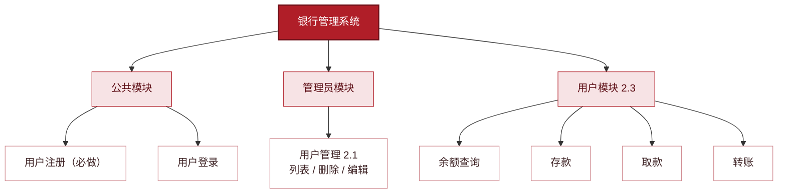

# Bank — 银行管理系统（课程大作业 · Java 内存版）

基于 Vue3 + Element Plus 前端与 Spring Boot 后端的银行管理系统。**后端不连接任何数据库**，全部数据保存在内存（`ConcurrentHashMap`），服务重启后自动恢复预置演示数据。

## 一、功能范围

| 模块 | 类型 | 要求要点 |
| :--- | :--- | :--- |
| 用户注册 | 必做 | RegisterView.vue，el-form（用户名/密码/确认密码），v-model 双向绑定，axios 提交；成功跳登录页，失败弹窗提示；注册自动开立账户 |
| 用户登录 | 隐含必备 | 返回用户角色；admin 进管理主页，普通用户进用户主页 |
| 用户管理 | 选做 2.1 | admin 登录后，左侧菜单切换，el-table 用户列表 + 删除/编辑按钮 |
| 普通用户主页 | 选做 2.3 | 显示当前用户账户余额；el-button 提供存款/取款/转账；点击不同按钮显示不同表单弹窗 |

> 按三选一要求本组合选择 2.1 + 2.3，未实现 2.2 账户管理模块。

**系统功能结构图**：



## 二、技术栈

- **前端**：Vue3 + Vite + Element Plus + Vue Router + Axios（yarn，端口 7995）
- **后端**：JDK 17 + Spring Boot 3.4（端口 6995），**无数据库依赖**
- **存储**：内存 `ConcurrentHashMap`（core/BankStore），重启恢复预置数据
- **联调**：Vite 把 `/api` 代理到 `http://localhost:6995`，后端零跨域代码

## 三、API 一览

| 方法 | 路径 | 说明 |
| :--- | :--- | :--- |
| POST | /api/register | 注册（查重 + 自动开户，账号 = 6216 + 用户ID 六位补零） |
| POST | /api/login | 登录（返回 id / username / role） |
| GET | /api/users | 用户列表（2.1，不含密码） |
| PUT | /api/users/{id} | 编辑用户（2.1，查重排除自己；密码留空不改） |
| DELETE | /api/users/{id} | 删除用户（2.1，admin 保护 + 级联删账户） |
| GET | /api/account/{userId} | 当前账户信息（2.3） |
| POST | /api/account/{userId}/deposit | 存款（2.3） |
| POST | /api/account/{userId}/withdraw | 取款（2.3，校验余额） |
| POST | /api/account/{userId}/transfer | 转账（2.3，一减一加保证一致） |

业务异常统一返回 `400 + {"message": "..."}`，由前端 axios 拦截器弹窗提示。

## 四、快速启动

```bash
# 后端（需 JDK 17 + Maven）
cd backend
mvn spring-boot:run        # 监听 6995

# 前端（需 Node + yarn）
cd frontend
yarn install               # 首次运行
yarn dev                   # 监听 7995，浏览器访问 http://localhost:7995
```

## 五、预置演示账号

| 用户名 | 密码 | 角色 | 账号 | 余额 |
| :--- | :--- | :--- | :--- | :--- |
| admin | 123456 | 管理员 | - | - |
| zhangsan | 123456 | 普通用户 | 6216000002 | 5200.00 |
| lisi | 123456 | 普通用户 | 6216000003 | 7800.25 |
| wangwu | 123456 | 普通用户 | 6216000004 | 320.50 |
