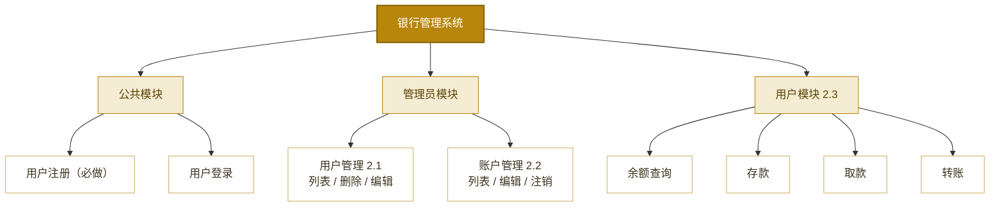

# System — 银行管理系统（课程大作业 · 纯前端版）

基于 Vue3 + Element Plus 的银行管理系统。**没有任何后端**，全部业务数据保存在浏览器 `localStorage`（键 `bank_system_db`），接口层用 Promise + 延时模拟网络请求。刷新页面、重开浏览器数据均不丢失；想重置演示数据，在浏览器控制台执行 `localStorage.removeItem('bank_system_db')` 后刷新即可。

## 一、功能范围

| 模块 | 类型 | 要求要点 |
| :--- | :--- | :--- |
| 用户注册 | 必做 | RegisterView.vue，el-form（用户名/密码/确认密码），v-model 双向绑定；成功跳登录页，失败弹窗提示；注册自动开立账户 |
| 用户登录 | 隐含必备 | 返回用户角色；admin 进管理主页，普通用户进用户主页 |
| 用户管理 | 选做 2.1 | admin 登录后，左侧菜单切换，el-table 用户列表 + 删除/编辑按钮 |
| 账户管理 | 选做 2.2 | 账户列表（联查用户名）+ 编辑（余额/状态）+ 注销（软删除，状态置「注销」，保留信息防丢失） |
| 普通用户主页 | 选做 2.3 | 显示当前用户账户余额；el-button 提供存款/取款/转账；点击不同按钮显示不同表单弹窗 |

> 三选一全做：本组合实现 2.1 + 2.2 + 2.3 全部三个选做模块。

**系统功能结构图**：



## 二、技术栈与架构

- **前端**：Vue3 + Vite + Element Plus + Vue Router（yarn，端口 7993），**无 Axios**
- **数据层**：`store/bank.js` —— `reactive()` 对象 + `watch(deep: true)` 监听，任意字段变化自动全量落盘 localStorage
- **接口层**：`api/bank.js` —— 每个导出函数对应一个"接口"，内部 `await delay(200)` 模拟网络延迟；业务失败抛 `Error(message)`，由 `call()` 包装统一 `ElMessage.error` 弹窗（角色等价于 axios 响应拦截器）
- **主题**：宁波银行金黄 `#b8860b`，Element Plus CSS 变量定制

**数据流转**：视图 → api/bank.js（模拟接口）→ store/bank.js（reactive 内存态）→ watch 自动持久化 → localStorage

## 三、模拟接口一览

| 函数 | 对应"接口" | 说明 |
| :--- | :--- | :--- |
| register | POST /register | 注册（查重 + 自动开户，账号 = 6228 + 用户ID 六位补零） |
| login | POST /login | 登录（返回 id / username / role） |
| listUsers | GET /users | 用户列表（2.1，手动剔除 password 字段） |
| updateUser | PUT /users/{id} | 编辑用户（2.1，查重排除自己；密码留空不改） |
| deleteUser | DELETE /users/{id} | 删除用户（2.1，admin 保护 + 级联删账户） |
| listAccounts | GET /accounts | 账户列表（2.2，联查用户名） |
| updateAccount | PUT /accounts/{id} | 编辑账户（2.2，余额非负校验） |
| closeAccount | DELETE /accounts/{id} | 注销账户（2.2，软删除：状态置「注销」） |
| getMyAccount | GET /account/{userId} | 当前账户信息（2.3） |
| deposit | POST /account/{userId}/deposit | 存款（2.3） |
| withdraw | POST /account/{userId}/withdraw | 取款（2.3，校验余额） |
| transfer | POST /account/{userId}/transfer | 转账（2.3，同一数据源内一减一加，一致性天然保证） |

## 四、快速启动

```bash
cd frontend
yarn install               # 首次运行
yarn dev                   # 监听 7993，浏览器访问 http://localhost:7993
```

> 无需启动任何后端服务。演示数据（1 管理员 + 3 用户 + 3 账户）在首次打开页面时自动写入 localStorage。

## 五、预置演示账号

| 用户名 | 密码 | 角色 | 账号 | 余额 |
| :--- | :--- | :--- | :--- | :--- |
| admin | 123456 | 管理员 | - | - |
| zhangsan | 123456 | 普通用户 | 6228000002 | 8600.00 |
| lisi | 123456 | 普通用户 | 6228000003 | 4300.75 |
| wangwu | 123456 | 普通用户 | 6228000004 | 666.66 |
